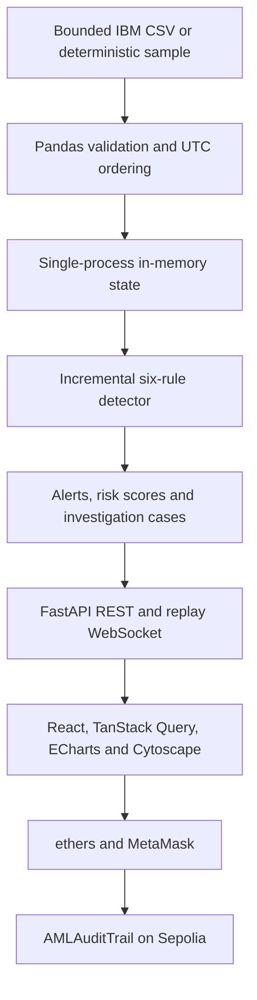

# Architecture

`backend/app/data.py` validates and normalizes the input. `detection.py` owns configurable rules and rolling per-account/currency contexts. `state.py` owns transactions, alerts, unique-rule scores, analytics caching and replay cursor. `models.py` defines validated command schemas and transitions. `graph.py` creates capped hop expansions. `evidence.py` defines canonical hashes. `main.py` exposes REST routes, centralized errors, structured lifecycle/error logging and the timestamp replay task.

All mutations execute under an application-level `asyncio.Lock`. The event loop performs read operations without awaits while iterating state. One Uvicorn worker is required: multiple workers create independent states and WebSocket client sets. Reruns are atomic and require paused replay. CPU-heavy detection is synchronous and can briefly block requests during a large rerun; the 100,000-row ceiling bounds this demonstration. Default samples use 3,000 rows for a fast laptop demo. Aggregate results cache until mutation; scoped aggregates recompute. Tables return at most 100 rows, network APIs at most 200 edges and 401 nodes.

`frontend/src/services/` separates HTTP, canonical evidence and Web3. Query cache invalidation updates connected views after reviews, reruns and replay. `components.tsx` contains chart/graph lifecycle cleanup, tables, drawers with focus handling, badges, pagination, errors and loading states. Page modules implement each actual workflow; `App.tsx` owns the responsive shell and WebSocket reconnect loop. Tailwind CSS is installed through the Vite plugin; theme styles are in `styles.css`.

The local app deliberately has no persistent database or application login. Demo reviewer names are descriptive, not blockchain credentials. Do not expose the local backend to untrusted networks. Contract state changes require a reviewer wallet, validated by Solidity. No private keys appear in configuration. API receipts are explicitly client-reported metadata; the Audit page uses RPC receipts, matching contract events, and stored version hashes to verify them.

Reset clears transactions/cases while retaining off-chain evidence archives within the process. Restart clears everything off-chain; block history is independent and immutable. Canonical evidence can be copied from the Audit page before restart for external record keeping. No real Sepolia contract is assumed to exist until configured.
